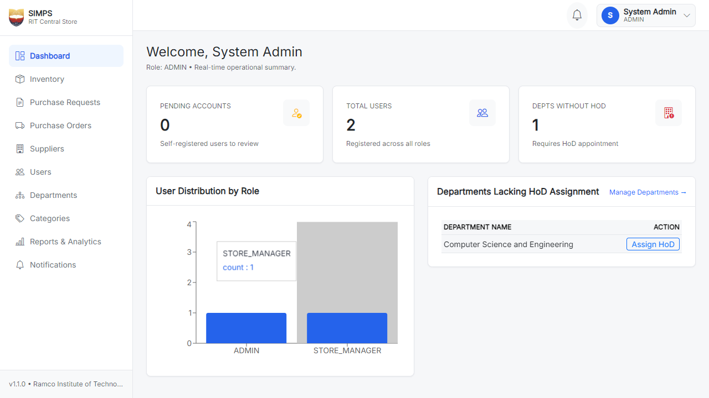
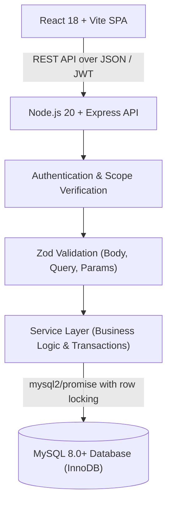
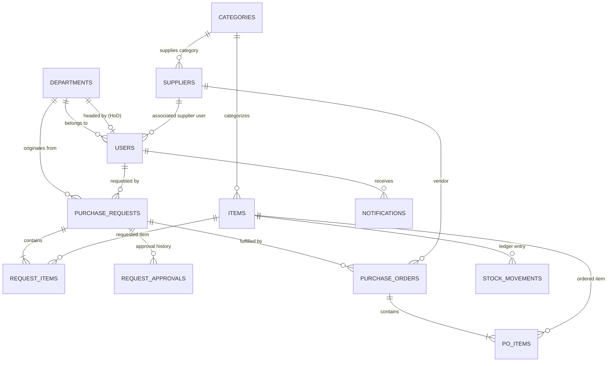
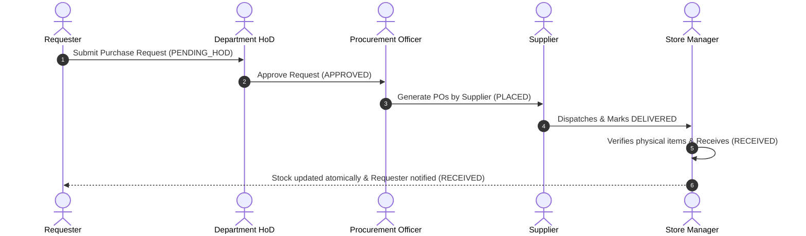

# SIMPS — Smart Inventory and Procurement Management System

[](https://github.com/viphakaran/SIMPS/actions/workflows/ci.yml)

A robust, full-featured web application designed for the Central Store of **Ramco Institute of Technology**. SIMPS manages inventory stock tracking, purchase requests with single-stage Head of Department (HoD) and Principal approvals, purchase orders to vendors, goods receipt with atomic stock updates, daily low-stock digests, and role-based analytical reports.

---

## Features

- **Master Data Management**: Comprehensive administration for Departments, Item Categories, and Approved Suppliers with active/inactive toggles and HoD assignment.
- **Role-Based Access Control**: 7 distinct roles (`ADMIN`, `PRINCIPAL`, `HOD`, `REQUESTER`, `PROCUREMENT_OFFICER`, `STORE_MANAGER`, `SUPPLIER`) with strict database-level and route-level scoping.
- **Single-Stage Approval Routing**: Requests raised by faculty/staff route to the department's active HoD. Requests raised by HoDs route directly to the Principal (preventing self-approval).
- **Atomic Stock Movements**: Stock increments and decrements use `SELECT ... FOR UPDATE` transactions, writing an immutable audit log to `stock_movements`.
- **Purchase Order Generation**: Procurement officers split multi-item approved requests into vendor-specific purchase orders with defined expected delivery dates.
- **Goods Receipt Verification**: Store managers verify delivered shipments; receiving goods automatically updates physical stock counts and marks request fulfillment.
- **Automated Alerts & Digest**: In-app notification center alerts users when requests change state or items fall below minimum levels; scheduled daily cron digests flag critical items at 08:00 AM.
- **Isolated Demo Engine**: Deterministic demo dataset (`npm run demo:load` / `npm run demo:clear`) tagged with `is_demo = 1` for presentations and testing without polluting real production records.

---

## Screenshots Placeholder

| Executive Dashboard | Purchase Request Workflow |
|---|---|
|  |  |

| Stock Ledger & Inventory | Purchase Orders & Receipt |
|---|---|
|  |  |

---

## System Architecture



---

## Entity-Relationship (ER) Diagram



---

## Procurement & Goods Receipt Workflow



---

## Prerequisites

- **Node.js**: `v20.x` or higher (verified via `.nvmrc`)
- **npm**: `v10.x` or higher
- **Docker & Docker Compose**: (Or an active local MySQL 8.0+ service)
- **Git**

---

## Quick Setup (Under 15 Minutes)

### 1. Clone & Install Dependencies
```bash
git clone https://github.com/viphakaran/SIMPS.git
cd SIMPS
npm install
```

### 2. Configure Environment Files
Create `.env` from example templates in `server/` and `client/`:
```bash
cp server/.env.example server/.env
cp client/.env.example client/.env
```

### 3. Start Database
```bash
docker compose up -d
```
Verify the container is healthy:
```bash
docker ps --filter "name=simps-mysql"
```

### 4. Run Migrations & Create First Admin
```bash
npm run migrate
npm run create-admin
```
Follow the interactive prompts to define the initial administrator's email and password.

### 5. Launch the Application
```bash
npm run dev
```
- **Web Client**: `http://localhost:5173`
- **API Server**: `http://localhost:5000`

---

## Environment Configuration

### Server (`server/.env`)
| Variable | Description | Default / Example |
|---|---|---|
| `PORT` | API server listen port | `5000` |
| `DB_HOST` | MySQL hostname | `127.0.0.1` |
| `DB_PORT` | MySQL port | `3306` |
| `DB_USER` | MySQL user | `root` |
| `DB_PASSWORD` | MySQL password | `(empty or your local password)` |
| `DB_NAME` | Primary database name | `smartinv` |
| `JWT_SECRET` | Secret key for signing JSON Web Tokens | `a-long-random-string-at-least-32-chars` |
| `JWT_EXPIRES_IN` | Token duration | `8h` |
| `CORS_ORIGIN` | Allowed client URL | `http://localhost:5173` |

### Client (`client/.env`)
| Variable | Description | Default / Example |
|---|---|---|
| `VITE_API_URL` | Base API target for client HTTP calls | `http://localhost:5000/api` |

---

## Available NPM Scripts

| Script | Command | Purpose |
|---|---|---|
| `npm run dev` | `concurrently ...` | Starts both client and server development servers simultaneously |
| `npm run migrate` | `node server/scripts/migrate.js` | Applies outstanding SQL migrations to the active database |
| `npm run create-admin`| `node server/scripts/create-admin.js` | Interactive CLI to provision the initial system administrator |
| `npm run demo:load` | `npm run demo:load -w demo` | Generates deterministic demo records (`is_demo = 1`) across all entities |
| `npm run demo:status`| `npm run demo:status -w demo` | Inspects database count of demo records vs production records |
| `npm run demo:clear` | `npm run demo:clear -w demo` | Safely purges all demo records without touching production data |
| `npm run lint` | `eslint .` | Runs ESLint across client, server, and demo workspaces |
| `npm test` | `npm run test -w server` | Runs complete server test suite (unit, integration, penetration tests) |
| `npm run test:e2e` | `npm run test:e2e -w client` | Executes end-to-end browser tests via Playwright |

---

## Demo Data Management

SIMPS features a demo data engine specifically crafted for academic presentations and demonstrations:
```bash
# Populate demo dataset
npm run demo:load

# Check current status
npm run demo:status

# Remove all demo records
npm run demo:clear
```
- **Demo users**: Password for all generated demo users is `DemoPass123!`.
- **Demo email domain**: Strictly uses `@demo.invalid`.
- **College institutional domain**: `ritrjpm.ac.in`.

---

## Project Structure

```
SIMPS/
├── .github/workflows/ci.yml       # GitHub Actions CI workflow
├── db/
│   └── 001_init.sql               # Base database schema
├── docs/
│   ├── ARCHITECTURE.md            # Technical architecture, locking & flows
│   ├── USER-GUIDE.md              # Role-by-role user manual
│   ├── TEST-REPORT.md             # Security review and test results
│   ├── SPEC.md                    # Functional requirements specification
│   ├── API.md                     # REST API endpoint definitions
│   └── UI.md                      # Design system and screen catalog
├── demo/
│   ├── load.js                    # Deterministic demo data generator
│   ├── status.js                  # Demo data presence report
│   └── clear.js                   # Cascade-safe demo data cleanup
├── server/
│   ├── src/
│   │   ├── config/                # DB pool & env configuration
│   │   ├── controllers/           # HTTP controllers
│   │   ├── middleware/            # Auth, role guarding, rate limiter, Zod
│   │   ├── routes/                # Express API route modules
│   │   ├── schemas/               # Zod validation schemas
│   │   ├── services/              # Business logic & SQL transaction operations
│   │   └── utils/                 # Errors, pagination & formatting
│   └── tests/                     # Jest & Supertest test suites
├── client/
│   ├── src/                       # React 18 frontend components & pages
│   └── e2e/                       # Playwright end-to-end browser tests
├── docker-compose.yml             # MySQL 8.0 local container definition
└── package.json                   # Workspaces root configuration
```

---

## License

This project is developed for educational purposes for **Ramco Institute of Technology**. All rights reserved.
