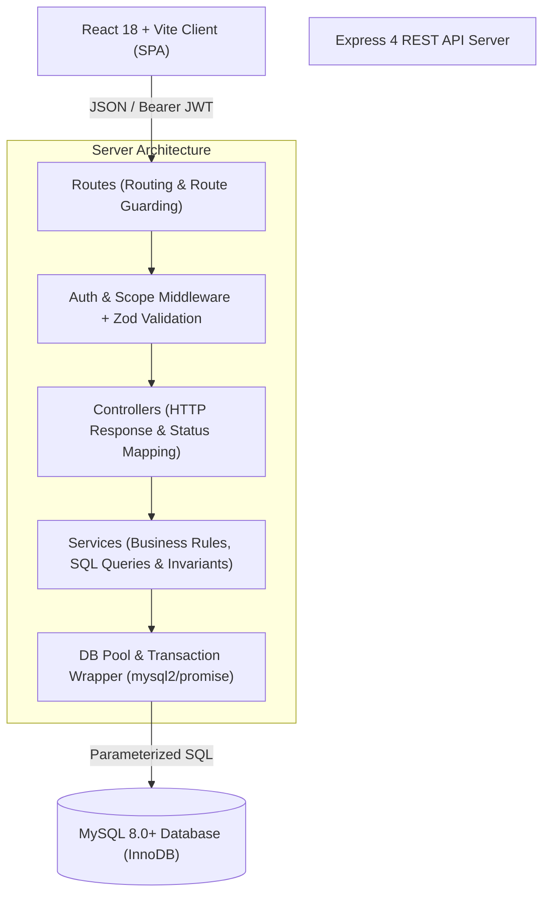
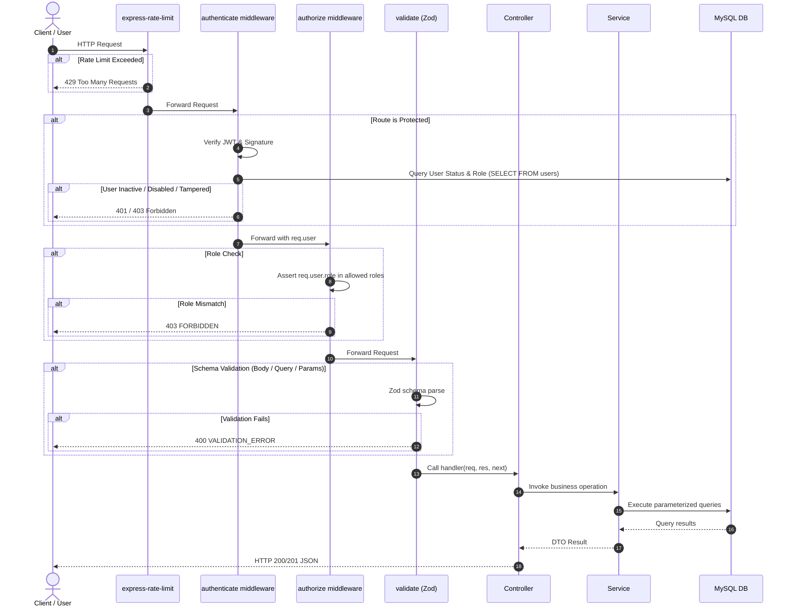
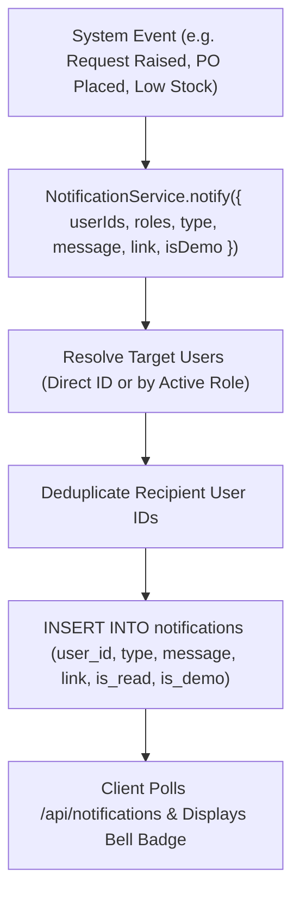

# SIMPS — Architecture & Technical Design

This document details the software architecture, technical patterns, request lifecycles, transaction guarantees, and notification mechanisms powering the Smart Inventory and Procurement Management System (SIMPS).

---

## 1. System Overview & Architectural Layers

SIMPS is structured as a modular three-tier client-server application adhering strictly to vanilla standards without heavyweight abstraction layers or ORMs.

### Layer Responsibilities
1. **Client Tier (`client/`)**: Single-Page Application (SPA) powered by React 18, React Router v6, Bootstrap 5, Bootstrap Icons, Axios, and Recharts. Implements client-side route guards based on authenticated user roles. Communicates with server exclusively via JSON API.
2. **Routing & Middleware Tier (`server/src/routes`, `server/src/middleware`)**: Handles route mapping, security headers (`helmet`), CORS enforcement, rate limiting, Bearer JWT authentication (`authenticate`), and role-based access control (`authorize`). Enforces Zod validation on request bodies, URL params, and query strings.
3. **Controller Tier (`server/src/controllers`)**: Marshals HTTP request data to services and formats responses according to standard envelope patterns (`{ data, page, pageSize, total }` for collections, or standard object shapes).
4. **Service Tier (`server/src/services`)**: Encapsulates 100% of business logic, database queries, and lifecycle invariants. Converts database `snake_case` records into camelCase DTOs at the boundary.
5. **Database Tier (`db/001_init.sql`, MySQL InnoDB)**: Relational storage engine with enforced Foreign Key constraints (`RESTRICT`, `CASCADE`, `SET NULL`), unique constraints, and strict data types.

---

## 2. Request Lifecycle & Security Verification Flow

Every incoming HTTP request traverses a multi-stage security pipeline before reaching business logic:

---

## 3. Transaction & Locking Strategy

To guarantee zero stock race conditions and prevent partial writes across related entities, SIMPS enforces strict transaction boundaries and row-level locking.

### A. Stock Movement Atomicity (`SELECT ... FOR UPDATE`)
All stock mutations (RECEIPT, ISSUE, ADJUSTMENT) must occur through `StockService.applyMovement`:
- The item record is locked with `SELECT id, stock_qty, min_level, low_stock_alerted FROM items WHERE id = ? FOR UPDATE`.
- The new stock quantity is computed in memory (`newQty = currentStock + delta`).
- Negative quantities are prevented: if `newQty < 0`, transaction aborts with `409 INSUFFICIENT_STOCK`.
- An immutable row is inserted into `stock_movements` recording `item_id`, `type`, `quantity`, `balance_after`, `po_id`, `department_id`, `recorded_by`, and `reason`.
- The `items.stock_qty` is updated.
- Low stock threshold check is performed: if `stock_qty <= min_level`, an in-app `LOW_STOCK` notification is dispatched to `STORE_MANAGER` and `PROCUREMENT_OFFICER`.

### B. Procurement Order Generation
Creating Purchase Orders from an Approved Purchase Request:
1. Begins a database transaction (`withTransaction`).
2. Locks the request and performs an atomic state transition:
   `UPDATE purchase_requests SET status = 'ORDERED' WHERE id = ? AND status = 'APPROVED'`.
   If `affectedRows === 0`, the transaction rolls back with `409 CONCURRENT_MODIFICATION`.
3. Records an approval history row in `request_approvals`.
4. Groups items by `supplier_id` and creates one `purchase_orders` record per distinct supplier.
5. Inserts corresponding `po_items` records and calculates line totals.
6. Notifies relevant suppliers and Store Managers.
7. Commits the transaction atomically.

### C. Goods Receipt
Receiving an order when physical items arrive at the central store:
1. Validates order status is `DELIVERED`.
2. Updates order status atomically:
   `UPDATE purchase_orders SET status = 'RECEIVED' WHERE id = ? AND status = 'DELIVERED'`.
3. Calls `StockService.applyMovement` for each line item in the PO, increasing stock quantity and recording `RECEIPT` movements.
4. Checks if all purchase orders linked to the underlying `request_id` have reached `RECEIVED`. If yes, advances `purchase_requests.status` to `RECEIVED`.
5. Emits notification to the original requester that goods have arrived.

---

## 4. Notification Dispatch & Lifecycle

Notifications in SIMPS are internal in-app alerts stored in the database and surfaced in real-time to authenticated users.

### Event Notification Mapping
| Event Trigger | Target Audience | Notification Type |
|---|---|---|
| Request submitted by Requester | Department HoD | `REQUEST_SUBMITTED` |
| Request submitted by HoD | Principal | `REQUEST_SUBMITTED` |
| Request Approved / Rejected | Requester | `REQUEST_APPROVED` / `REQUEST_REJECTED` |
| Request Returned for Revision | Requester | `REQUEST_RETURNED` |
| Purchase Orders Placed | Assigned Supplier(s) | `ORDER_PLACED` |
| Order Marked Delivered | Store Managers | `ORDER_DELIVERED` |
| Order Goods Received | Original Requester | `ORDER_RECEIVED` |
| Stock Quantity <= Min Level | Store Managers & Procurement Officers | `LOW_STOCK` |
| Daily 08:00 AM Stock Digest | Procurement Officers | `LOW_STOCK` / `DAILY_DIGEST` |
| New Account Approved | Newly Approved User | `ACCOUNT_APPROVED` |

---

## 5. Demo Data Isolation Architecture

To ensure zero cross-contamination between production data and academic testing data:
- Every table includes an `is_demo TINYINT(1) DEFAULT 0` column.
- Any entity created by normal application usage that references a demo entity (e.g., a purchase request referencing a demo item or demo user) inherits `is_demo = 1`.
- `npm run demo:clear` issues cascade-safe deletions targeting strictly `WHERE is_demo = 1`. Real data with `is_demo = 0` is never touched.
- A visual yellow pill banner appears in the navbar whenever demo data is detected in the system.
